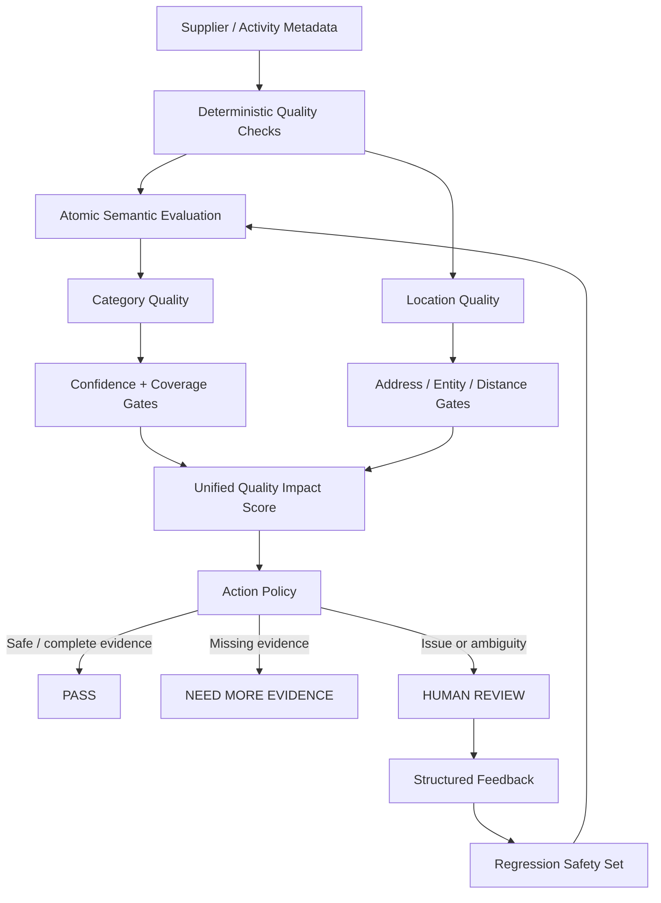

# Activity Metadata Quality Platform

**An eval-driven metadata quality system for travel marketplaces.**

The project explores a practical question:

> How can a marketplace use LLMs to improve supplier metadata without letting model confidence directly mutate the catalog?

The answer implemented here is a guarded decision system:

```text
Supplier metadata
      ↓
Deterministic checks
      ↓
Semantic evaluation
      ↓
Quality gates
      ↓
Quality Impact Score
      ↓
Action policy
      ↓
Human review
      ↓
Structured feedback
      ↓
Regression safety set
```

The emphasis is not on “using an LLM”. It is on **defining quality, measuring it, routing uncertainty, preventing unsafe actions, and learning from reviewed cases**.

---

## 60-second demo

Run:

```bash
python -m src.demo.run_demo
```

No API key or paid inference is required. The demo uses cached real evaluation artifacts.

The default case is **Acorn 20/20**:

```text
Source address: 20 Richmond Rd
              ↓
Geocoder disagreement: 26.9 km
              ↓
Naive conclusion:
"bad pin"

Actual system:
ADDRESS_OR_GEOCODER_REVIEW
              ↓
Quality Impact Score = 35 / 100
              ↓
HUMAN_REVIEW
              ↓
Evidence confirms:
address context incomplete
              ↓
coordinate is NOT overwritten
              ↓
case becomes regression protection
```

This is the core product behavior of the prototype: **detection does not automatically become action**.

- [Executive demo walkthrough](docs/end-to-end-demo.md)
- [Generated demo snapshot](reports/demo/end_to_end_demo.md)
- [Machine-readable trace](reports/demo/end_to_end_demo.json)

---

## Why this problem matters

Marketplace activity listings are supplier-generated and often incomplete, inconsistent, ambiguous, or difficult to classify.

Examples:

- an activity belongs to a category semantically but does not contain the category keyword;
- a location has valid coordinates but an underspecified address;
- an address resolves successfully, but to the wrong entity;
- the model is confident while the underlying catalog label is noisy;
- two quality signals disagree about which field is actually wrong.

A production system therefore needs more than classification accuracy.

It needs to answer:

1. **What does “good” mean?**
2. **Which field is probably wrong?**
3. **How confident are we?**
4. **Do we have enough evidence to act?**
5. **Should this be automated or reviewed?**
6. **How does reviewer feedback improve future decisions?**

---

## Architecture



### Design principles

**1. Ontology before prompting**

The LLM does not decide what a “museum”, “nature activity”, or acceptable location means. Explicit business definitions live in configuration and are versioned.

**2. Atomic evaluation**

The semantic evaluator makes one narrow decision at a time:

```json
{
  "decision": "member | not_member | uncertain",
  "confidence": 0.0,
  "reason_codes": ["..."],
  "evidence": "..."
}
```

**3. Abstention is a feature**

Uncertain cases and provider failures route to review instead of being forced into a prediction.

**4. Detection ≠ diagnosis ≠ action**

A large inconsistency is not automatically proof that one specific field is wrong.

**5. Coverage matters**

Missing evidence is not treated as good quality. A partial score cannot become a full `PASS`.

**6. Feedback does not become truth automatically**

Assisted adjudication can create regression safety cases, but only independent human gold is eligible for threshold calibration.

---

## Real-data results

The project uses the **Enriched Tourism Dataset London (POIs)** with public category annotations.

- 2,264 catalog entities used in category evaluation
- CC BY 4.0
- DOI: `10.6084/m9.figshare.27628029`

### Category evaluation

| Evaluation | Representative holdout | Model coverage | Precision* | Recall* | F1* |
|---|---:|---:|---:|---:|---:|
| Museum | 600 | 95.3% | 47.1% | 100% | 64.0% |
| Nature | 600 | 95.8% | 90.6% | 85.2% | 87.8% |

\*Against the public dataset labels.

The museum result exposed an important evaluation problem: several apparent errors were likely **annotation or ontology disagreements**, not straightforward model failures. The repository therefore keeps public-label metrics separate from human-gold claims.

For `nature`, the original deterministic baseline had only **0.47% recall**. The semantic evaluator demonstrated why implicit semantic categories require more than lexical matching.

### Location quality

A deterministic 30-row diagnostic sample produced:

```text
PASS                         18
ADDRESS_QUALITY_REVIEW        5
GEOCODER_UNRESOLVED_REVIEW    3
BOUNDARY_REVIEW               2
ADDRESS_OR_GEOCODER_REVIEW    2
COORDINATE_MISMATCH_CANDIDATE 0
```

The most important result is the last one.

Two apparently severe distance anomalies were independently reviewed. Both were **address-side problems**, not confirmed bad coordinates.

The quality gate prevented an unsafe rule such as:

```text
large geocoder distance → overwrite pin
```

### Unified prioritization

The Category and Location signals are combined into a transparent **Quality Impact Score**.

Current real-data overlap:

```text
30 scored entities
13 full-domain scores
17 partial-domain scores

Full scores:
MEDIUM  5
LOW     4
NONE    4
```

The score is a **review-prioritization heuristic**, not a conversion or revenue prediction.

### Action policy

The policy layer turns quality evidence into an operational recommendation:

```text
HUMAN_REVIEW          15
NEED_MORE_EVIDENCE    11
PASS                    4
```

11 records are eligible for **internal auto-flagging**.

External actions remain disabled:

```text
supplier_contact_enabled = false
metadata_mutation_enabled = false
production_enabled = false
```

### Closed-loop feedback

Two real location cases have been adjudicated with assisted evidence review:

```text
Reviewed cases                 2
Confirmed address defects      2
Confirmed coordinate changes   0
Regression cases created       2
Threshold changes              0
Retraining triggered           false
```

Their reviewed outcomes now protect the pipeline from reintroducing the same unsafe `bad pin` behavior.

---

## End-to-end decision example

For **Acorn 20/20**:

| Stage | Output |
|---|---|
| Detection | 26,915 m address-coordinate disagreement |
| Quality gate | `ADDRESS_OR_GEOCODER_REVIEW` |
| Likely problem | address or reference resolution |
| Impact score | 35 / 100 |
| Coverage | partial |
| Action | `HUMAN_REVIEW` |
| Review outcome | address context incomplete |
| Coordinate mutation | none |
| Learning outcome | regression safety case |

The reviewed address evidence indicates that the original `20 Richmond Rd` lacked sufficient locality context, causing the geocoder to resolve another Richmond Road.

The point of the case is not that geocoding is difficult.

The point is that a safe quality system must identify **what it knows, what it does not know, and what action is justified by the evidence**.

---

## What I would measure in production

Offline model metrics are necessary but not sufficient.

For a marketplace deployment I would instrument:

### Evaluator quality

- precision / recall by metadata field and category;
- abstention rate;
- calibration error;
- regression-suite pass rate;
- false-pass rate;
- false-remediation rate.

### Operations

- percentage auto-passed;
- percentage routed to review;
- review precision;
- average review time;
- supplier-fix acceptance rate;
- repeat-defect rate.

### Marketplace impact

Only after the quality system is reliable would I connect it to downstream metrics such as:

- listing discovery / retrieval coverage;
- search-to-detail conversion;
- detail-to-booking conversion;
- supplier content completion;
- support contacts;
- cancellations attributable to incorrect metadata.

The current `Quality Impact Score` deliberately does **not** claim to estimate these outcomes.

---

## Key trade-offs

### Precision vs automation coverage

Higher confidence thresholds reduce unsafe auto-routing but increase human-review volume.

The museum routing experiments explicitly evaluate this trade-off. Cost optimization is subordinate to safety constraints.

### LLM judgment vs deterministic rules

Deterministic checks are cheap, reproducible, and strong for explicit constraints.

LLMs are more useful when membership is semantic or contextual.

The architecture uses both instead of forcing every problem through an LLM.

### Public labels vs actual ground truth

A dataset label is an evaluation reference, not automatically truth.

Disagreements are routed for adjudication rather than silently counted as model errors.

### Self-learning vs governance

Reviewer feedback is valuable, but automatic online retraining would create circular evaluation risk.

The system therefore distinguishes:

```text
assisted feedback
→ regression protection

independent human gold
→ future calibration candidate
```

---

## If I were taking this into GetYourGuide

This prototype is intentionally small. The next production-oriented sequence I would propose is:

### 1. Start with one high-value metadata domain

Choose a defect type with:

- measurable user or supplier impact;
- enough historical examples;
- clear ownership;
- a realistic review workflow.

### 2. Define the ontology and action contract

Before model work, agree on:

- what “correct” means;
- acceptable granularity;
- fields the system may recommend changing;
- actions that require human confirmation;
- irreversible / high-risk actions that cannot be automated.

### 3. Build an independent gold set

Sample across:

- countries;
- activity categories;
- suppliers;
- languages;
- head and long-tail inventory;
- known failure modes.

### 4. Run shadow mode

Generate decisions and proposed actions without changing production metadata.

Measure:

- precision by action lane;
- review reduction;
- false-remediation risk;
- coverage.

### 5. Introduce automation asymmetrically

Start only with low-risk, high-precision lanes.

For example:

```text
high-confidence internal flag
        before
supplier-facing correction request
        before
automatic catalog mutation
```

### 6. Close the feedback loop

Every accepted/rejected recommendation should become evaluation data, with clear separation between:

- operational feedback;
- assisted adjudication;
- independent human gold.

---

## Repository guide

The shortest path through the repository:

| Topic | File |
|---|---|
| End-to-end demo | [docs/end-to-end-demo.md](docs/end-to-end-demo.md) |
| Interview narrative | [docs/interview-narrative.md](docs/interview-narrative.md) |
| Category ontology | [config/category_ontology.yml](config/category_ontology.yml) |
| Museum holdout | [reports/phase5/holdout_summary.json](reports/phase5/holdout_summary.json) |
| Nature holdout | [reports/categories/nature/phase5/holdout_summary.json](reports/categories/nature/phase5/holdout_summary.json) |
| Location gate | [docs/location-adjudication.md](docs/location-adjudication.md) |
| Unified impact score | [docs/quality-impact-score.md](docs/quality-impact-score.md) |
| Action policy | [docs/quality-action-policy.md](docs/quality-action-policy.md) |
| Feedback loop | [docs/closed-loop-feedback.md](docs/closed-loop-feedback.md) |

---

## Reproduce locally

```bash
python -m venv .venv
source .venv/bin/activate  # Windows PowerShell: .venv\Scripts\Activate.ps1
pip install -e ".[dev]"
pytest -q
python -m src.demo.run_demo
```

The demo uses committed evaluation artifacts and does not require Gemini access.

For new semantic inference:

```bash
export GEMINI_API_KEY="..."
python -m src.semantic.run_phase3 \
  --category museum \
  --sample-size 240 \
  --model gemini-3.8-flash
```

Raw external data and credentials are not committed.

---

## Project status

This is a **pre-production prototype**.

Implemented:

- real-data ingestion;
- explicit category ontology;
- deterministic baselines;
- structured Gemini evaluation;
- confidence / abstention routing;
- representative holdouts;
- human-review workflow;
- location consistency diagnostics;
- address/entity safety gates;
- unified quality prioritization;
- operational action policy;
- structured feedback;
- regression safety cases;
- reproducible executive demo.

Not claimed:

- production-ready thresholds;
- independent human-gold coverage at scale;
- causal conversion impact;
- automatic supplier communication;
- automatic catalog mutation;
- autonomous retraining.
